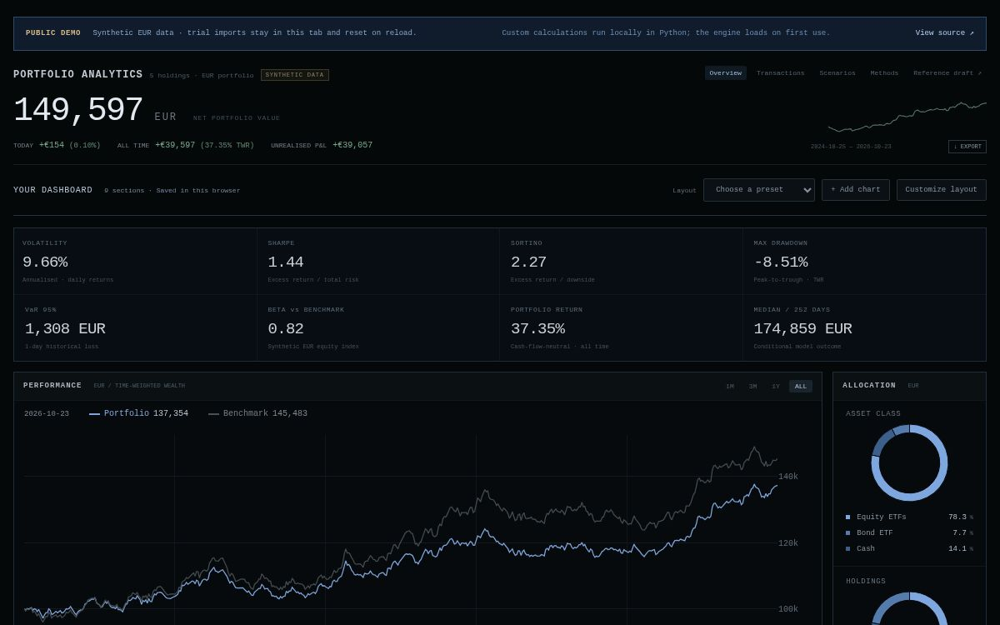

# Meridian · Portfolio Analytics

[Live web app](https://meridian-portfolio-analytics-alkova11.adeptrhea24.chatgpt.site) · [GitHub repository](https://github.com/alkova11/meridian-portfolio-analytics) · [Dashboard PNG](https://raw.githubusercontent.com/alkova11/meridian-portfolio-analytics/main/reports/figures/dashboard-live.png)

A configurable portfolio dashboard with a Python accounting and risk engine. Choose the charts you want, inspect historical performance and explore reproducible simulation scenarios—while keeping cash flows separate from investment returns.

**Python · FastAPI · React · TypeScript · Plotly · Parquet**



*Actual published dashboard captured by the hosting service. All displayed data are synthetic EUR examples; no API keys or live market connection are required. A separate [research figure](reports/figures/project-overview.png) shows the calculated wealth, drawdown and simulation bands.*

## The problem

An account balance can rise because investments earned a return or because cash was deposited. Meridian derives positions and cash from a transaction ledger, then calculates daily flow-aware portfolio performance. It connects those calculations to an interface where the numerical assumptions stay visible.

## What is implemented

| Area | Behavior |
|---|---|
| Accounting | Decimal FIFO lots, fractional quantities, purchases/sales, dividends, fees, splits, deposits/withdrawals; cash and oversell validation |
| Performance | Daily valuation, start-of-day cash-flow-aware time-weighted returns, aligned synthetic EUR benchmark, realised/unrealised gains |
| Risk | Volatility, downside deviation, Sharpe, Sortino, maximum drawdown/recovery, 1-day historical VaR95, beta, concentration and asset correlations |
| Simulation | Seeded correlated lognormal and joint five-day block-bootstrap models; buy-and-hold units and constant cash; default 10,000 paths / 252 weekday steps |
| Scenarios | Fixed-holdings shocks and historical price-window replay, with attribution |
| Data workflow | Validated CSV preview/commit, idempotent imports, Parquet sample observations, frozen run inputs/configuration and downloadable JSON exports |
| Dashboard builder | Ten available analytical sections; add/remove, reorder, width/height settings, display variants, benchmark toggle, three presets and browser-local persistence |
| Interaction | Shared-date performance inspection, drawdown guides, precomputed fan quantiles and fixed terminal summaries; keyboard inspection and correlation data table |

The fixed reference-led design remains at `/draft/`. The main `/` route is the configurable workspace. The older first design has been removed from the application.

## Run locally

Prerequisites: Python 3.12–3.14, uv and Node.js 22.12+ (Node 24 recommended). Local validation used Python 3.14.7. Run from this project directory:

```sh
uv sync --locked
uv run uvicorn backend.app.main:app --host 127.0.0.1 --port 8010
```

In another terminal:

```sh
cd frontend
npm ci
npm run dev -- --port 5173
```

Open [the dashboard](http://127.0.0.1:5173), [the fixed reference draft](http://127.0.0.1:5173/draft/) or [the API documentation](http://127.0.0.1:8010/docs).

If uv is unavailable, bootstrap it inside this project with `python3 -m venv .venv` followed by `.venv/bin/python -m pip install uv`, then substitute `.venv/bin/uv` for `uv` above.

Use a single backend worker. Generated state lives in `data/processed/`; imports persist across backend restarts. Layout choices live separately in the browser's local storage. If browser storage is blocked, the interface reports session-only persistence.

## Configure your dashboard

1. Choose **Add chart** to open the chart library. Available sections include performance, allocation, drawdown, Monte Carlo, terminal outcomes, historical return distribution, metrics, holdings, risk explanations and correlations.
2. Choose **Customize layout** to move sections with ↑/↓, remove them and change their width/height.
3. Select available styles: line/area for performance and drawdown, donut/bar for allocation, bar/line for distributions. The Monte Carlo fan retains its percentile-band convention.
4. Toggle the benchmark or use **Reference layout**, **Performance focus** or **Risk focus** presets. Changes save automatically in that browser; the fixed draft is unaffected.

## Reproduce and verify

```sh
uv run pytest -q
uv run ruff check src backend tests scripts
uv run ruff format --check src backend tests scripts
cd frontend
npm test
npm run build
```

To regenerate the standalone synthetic research figure, from the project root:

```sh
uv run --group publication python scripts/export_publication_data.py
uv run --group publication python scripts/render_project_figure.py
```

Optional plotting dependencies are included in the lockfile under the publication group. Figure inputs are the bundled synthetic fixture, never the user's imported portfolio. Saved output records the seed, configuration and dataset/lock hashes.

The Playwright workflow is available via `npm run test:e2e` after installing its browser with `npx playwright install chromium` and starting both servers. Browser visual/end-to-end validation has **not passed in this environment** because saved browser-origin policy prevents localhost observation. Local numerical checks and a successful build are not a claim of a passing GitHub Actions run. See [the validation record](docs/VALIDATION.md).


## Public web version

The public application runs without a local API server. It starts with cached, provenance-labelled synthetic results, then executes the same Python application functions in a Pyodide 314.0.7 module worker for custom simulations, scenarios and CSV imports. Each visitor gets isolated in-memory state; imports are not uploaded and reset on page reload. Layout preferences remain in browser local storage.

```sh
# After uv sync and npm ci, from frontend/
npm run build:public
# Optional numerical worker integration check; first run downloads pinned Python wheels
npm run test:public-runtime
```

Serve `frontend/dist-public/` on HTTPS static hosting. No Python server, broker login or account is required by visitors. Runtime package versions are recorded in custom-run exports; seeded paths are reproducible within that runtime, with no promise of bitwise equality across native and WebAssembly numerical libraries.

## Synthetic example

The bundled fixture spans 2024-10-25 through 2026-10-23. It produces EUR 149,597.39 in final portfolio value, including EUR 21,030 cash and EUR 110,000 net external capital. Historical annualised volatility is approximately 9.66% and maximum drawdown approximately −8.51%. These are synthetic demonstration outputs, not an investment track record.

The seed-42 simulation generates conditional portfolio paths using current units and cash. Its terminal probabilities and quantiles depend on the model, calibration sample and contributions policy; they are not calibrated forecasts or promised outcomes.

## CSV transactions

[Example CSV](data/sample/deposit.csv). Supported EUR symbols: EQUA, TECH, EURO, BOND, GOLD. Dates must be present in the fixed sample weekday calendar.

Quantity is positive. BUY `cash_amount = -quantity × price`; SELL `cash_amount = quantity × price`. Fees are nonnegative and deducted separately. DEPOSIT/DIVIDEND cash is positive, WITHDRAWAL/FEE cash is negative. SPLIT quantity is the units multiplier with zero price/cash/fee. Import preview checks the combined ledger before commit.

## Architecture

```text
src/portfolio_analytics/   Decimal ledger, valuation, returns, risk, simulation
backend/app/              FastAPI validation, orchestration and local run storage
frontend/src/dashboard/   Configurable layout, persistence and chart library
frontend/src/charts/      Plotly rendering and local pointer/keyboard inspection
frontend/src/draft-v2/    Preserved reference-led interface
scripts/                  Synthetic publication export, figure and source packaging
tests/                    Independent numerical fixtures and API integration checks
```

[Methodology](docs/METHODOLOGY.md) · [Data provenance](docs/DATA.md) · [Validation](docs/VALIDATION.md) · [Contributing](CONTRIBUTING.md)

## Conventions and limits

Long-only EUR equities/ETFs and cash, local single-user operation. No FX, crypto, broker connection, authentication, tax engine or live-market provider. Sample instruments and benchmark are synthetic. Raw asset prices and dividend cash flows are accounted separately.

Risk uses daily simple TWR, 252-day annualisation and a 2% effective annual risk-free rate. VaR is a 1-day historical loss threshold. Performance graphs show indexed, cash-flow-neutral wealth. Simulations exclude future dividends/contributions, leave cash at zero yield and use a weekday calendar without exchange-holiday exclusions. Normal and bootstrap models do not establish forecast accuracy.

The interface composition was informed by a user-supplied reference video. Original media are not redistributed, and exact visual fidelity has not been certified. The public demo runs the Python engine in an isolated browser worker; the native FastAPI server remains available for local use. Trial imports in the public version stay in the tab and reset on reload. The default synthetic view is precomputed by the same Python package; custom calculations load the pinned Pyodide runtime on first use. A public-use licence has not yet been selected.
